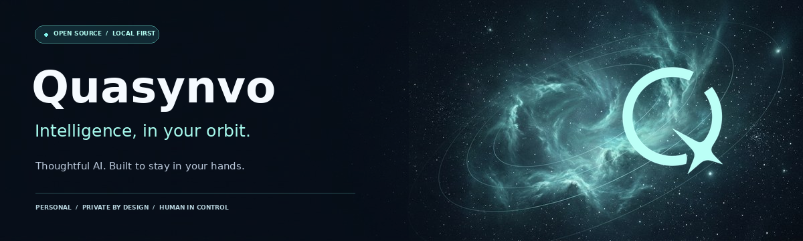

<div align="center">

<a href="https://github.com/Quasynvo"></a>

### Thoughtful AI, closer to home.

We build open-source tools that help people do more with AI—<br />
without losing sight of what runs, where data goes, or who is in control.

[**Explore Quasnooze →**](https://github.com/Quasynvo/Quasnooze) &nbsp; · &nbsp; [Get started](https://github.com/Quasynvo/Quasnooze#start-in-three-steps) &nbsp; · &nbsp; [Contribute](https://github.com/Quasynvo/.github/blob/main/CONTRIBUTING.md) &nbsp; · &nbsp; [Security](https://github.com/Quasynvo/.github/blob/main/SECURITY.md)

<sub>Static artwork by default · [View the decorative animated banner](https://raw.githubusercontent.com/Quasynvo/.github/main/profile/banner.gif)</sub>

</div>

---

## Meet Quasnooze ✦

**Your everyday tools. A cosmic companion. Your permission, first.**

[Quasnooze](https://github.com/Quasynvo/Quasnooze) is our local-first personal assistant. It runs on your computer, works with Ollama, and brings conversation, useful tools and a little cosmic calm into one place.

<a href="https://github.com/Quasynvo/Quasnooze"></a>

<sub>Illustrated, scripted UI preview—not a live model response or microphone demonstration.</sub>

- **Think & create** — ask questions, draft, plan, and use personas and remembered facts.
- **Find & remember** — search supported documents and local history, set reminders, and work with attachments.
- **Act with visibility** — inspect tool activity and approve sensitive actions before they run, subject to your configured policies.
- **Stay connected** — use the browser, the Windows companion, or optional Telegram, Discord, Slack and WhatsApp channels.

[**Explore the project →**](https://github.com/Quasynvo/Quasnooze) &nbsp; · &nbsp; [Capabilities](https://github.com/Quasynvo/Quasnooze/blob/main/docs/CAPABILITIES.json) &nbsp; · &nbsp; [Desktop guide](https://github.com/Quasynvo/Quasnooze/blob/main/docs/DESKTOP.md)

## Made for people, not mystery

**Local-first, by choice.** Ollama can handle reasoning on your own machine. Optional cloud providers, network tools and messaging channels have separate data boundaries.

**Your actions, your say.** Workspace policies, visible activity and approval prompts put people in the loop. A wake phrase is not authentication; local software is not automatically encrypted or OS-sandboxed.

**Open by nature.** Read the code, check the evidence, report a problem or help make it better. We value honest limits over inflated claims.

## Start your orbit

You'll need **Node.js 22+** and a configured, running Ollama model for real local reasoning.

```sh
git clone https://github.com/Quasynvo/Quasnooze.git
cd Quasnooze
npm run setup
npm run doctor
npm run brain
npm start
```

For the Windows tray/widget, use `npm run desktop` instead. The web and configured-channel assistant also runs on Linux and macOS. Keep an unauthenticated server local; see the [complete setup guide](https://github.com/Quasynvo/Quasnooze#start-in-three-steps) before exposing services or enabling powerful tools.

<details>
<summary><strong>Product status & privacy notes</strong></summary>

The Windows resident and illustrated conversation experiences are **previews**. Physical wake-word, microphone, startup and accessibility acceptance still need testing. The companion is a **2.5D illustration**, not a VR/3D model or phoneme-accurate lipsync system.

Browser speech recognition may involve its vendor; native Windows voice is the local option. Optional integrations can send data to their providers. See the [voice guide](https://github.com/Quasynvo/Quasnooze/blob/main/docs/VOICE.md), [security audit and known limits](https://github.com/Quasynvo/Quasnooze/blob/main/docs/AUDIT.md), and [capability inventory](https://github.com/Quasynvo/Quasnooze/blob/main/docs/CAPABILITIES.json).

</details>

<details>
<summary><strong>Previously using Pinch?</strong></summary>

The project is now **Quasnooze by Quasynvo**. Existing CLI/configuration aliases and saved state remain supported. See the [migration rules](https://github.com/Quasynvo/Quasnooze/blob/main/docs/REBRANDING.md).

</details>

---

## Build with us

There is room for more than code. Improve a guide, reproduce a bug, review a change, or bring a focused idea to the conversation.

[**Find an issue →**](https://github.com/Quasynvo/Quasnooze/issues) &nbsp; · &nbsp; [Help-wanted tasks](https://github.com/Quasynvo/Quasnooze/issues?q=is%3Aissue+is%3Aopen+label%3A%22help+wanted%22) &nbsp; · &nbsp; [Contribution guide](https://github.com/Quasynvo/.github/blob/main/CONTRIBUTING.md) &nbsp; · &nbsp; [Code of Conduct](https://github.com/Quasynvo/.github/blob/main/CODE_OF_CONDUCT.md)

Found a security issue? [Report it privately](https://github.com/Quasynvo/.github/blob/main/SECURITY.md)—please don't post credentials or vulnerability details in a public issue. Need help with the product? See [Quasnooze support](https://github.com/Quasynvo/Quasnooze/blob/main/docs/SUPPORT.md).

<div align="center">
<br />
<strong>Quasynvo</strong> · Intelligence, in your orbit.<br />
<sub>Maintained by <a href="https://github.com/RANJITHROSAN17">Ranjith Rosan</a> and open-source contributors.</sub>
</div>
