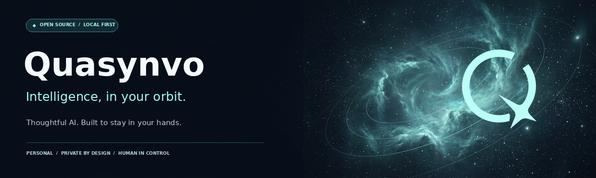

<div align="center">



<br /><br />

**Software that runs on your machine, not someone else's.**

[**Pinch**](https://github.com/pinchfoundry/Pinch) · [Docs](https://pinchfoundry.github.io/Pinch/) · [Good first issues](https://github.com/pinchfoundry/Pinch/labels/good%20first%20issue) · [Contributing](https://github.com/pinchfoundry/.github/blob/main/CONTRIBUTING.md)

</div>

---

## Why this org exists

Every assistant now wants your data in its cloud, your keys in its vault, and your attention in its
subscription funnel. Pinch Foundry builds the other thing: software you own, run, and can read all
the way through.

Three rules we don't break:

| Rule | What it means in practice |
| :--- | :--- |
| **It runs on your hardware** | Local model by default. No account, no server of ours in the path. |
| **It is inspectable** | Source, capability evidence and a documented security review are public. Inspect the current revision before granting tool access; a review is not a safety guarantee. |
| **It admits what it can't do** | Our own [security audit](https://github.com/pinchfoundry/Pinch/blob/main/docs/AUDIT.md) lists the findings we haven't fixed yet. |

---

## Projects

<table>
<tr>
<td width="50%" valign="top">

### 🦞 [Pinch](https://github.com/pinchfoundry/Pinch)

A local-first personal AI assistant you message from Telegram, Discord, Slack, WhatsApp or a
browser tab. Reads files, runs commands behind an approval gate, remembers you, runs your
reminders.

`zero runtime dependencies` · `MIT` · `Node 22+`

[**Get started →**](https://github.com/pinchfoundry/Pinch#install-it-in-two-commands)

</td>
<td width="50%" valign="top">

### 🧰 `.github`

You're looking at it. Org-wide community health defaults — code of conduct, contributing guide,
security policy, issue and PR templates — inherited by every repo we create.

`the boring infrastructure that makes contributions possible`

[**Read the defaults →**](https://github.com/pinchfoundry/.github)

</td>
</tr>
</table>

---

## Try before configuring accounts

From a Pinch clone with Node.js 22+, run `npm run demo` to inspect the canned interaction flow without model or messaging credentials. The demo is scripted evidence of the interface, not a real-model benchmark. It disables the panel key; do not expose or forward its port, and do not treat it as a security sandbox. For actual use, keep the model local unless you deliberately opt into a cloud provider; messaging platforms have their own data policies.

## How to get involved

```bash
git clone https://github.com/pinchfoundry/Pinch && cd Pinch
npm run setup     # one guided command: model → channels → voice → key
npm start         # http://localhost:7777
```

No build step. No dependency install. If it runs, you can hack on it.

**Three ways to start, in order of effort:**

| Time | Do this |
| :--- | :--- |
| **First check** | Run `npm run doctor` from your Pinch clone; report a reproducible problem with redacted diagnostics |
| **1 hour** | Pick a [good first issue](https://github.com/pinchfoundry/Pinch/labels/good%20first%20issue) — each one names the exact files and the command that proves it works |
| **A weekend** | Add a tool. [CONTRIBUTING.md](https://github.com/pinchfoundry/.github/blob/main/CONTRIBUTING.md) has the whole recipe, and it is genuinely small |

Every fix needs a regression test. Not because we like ceremony — because a bug that comes back
once will come back again.

---

## Maintainer

**[Ranjith Rosan](https://github.com/RANJITHROSAN17)** maintains Pinch Foundry’s organisation profile and community-health defaults. Pinch and its community contributors are credited in the [project repository](https://github.com/pinchfoundry/Pinch).

## Community & governance

| | |
| :--- | :--- |
| **Code of Conduct** | [Contributor Covenant v2.1](https://github.com/pinchfoundry/.github/blob/main/CODE_OF_CONDUCT.md) — enforced |
| **Security** | [Report privately](https://github.com/pinchfoundry/.github/blob/main/SECURITY.md). Never in a public issue. |
| **Contributing** | [CONTRIBUTING.md](https://github.com/pinchfoundry/.github/blob/main/CONTRIBUTING.md) — setup, style, commit conventions |
| **Support** | [docs/SUPPORT.md](https://github.com/pinchfoundry/Pinch/blob/main/docs/SUPPORT.md) |
| **Roadmap** | [.github/roadmap.json](https://github.com/pinchfoundry/Pinch/blob/main/.github/roadmap.json) — human-reviewed, never generated |

<div align="center">
<br />
<sub>Built to run on a laptop, in a room, for one person. 🦞</sub>
</div>
